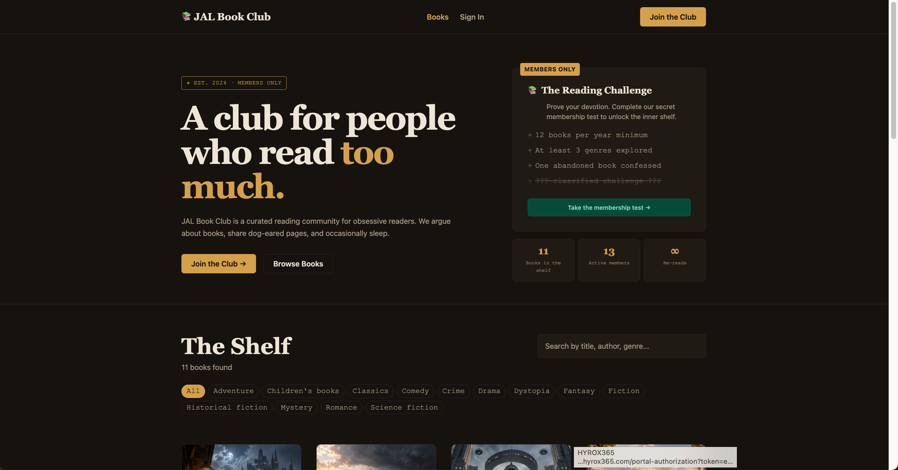
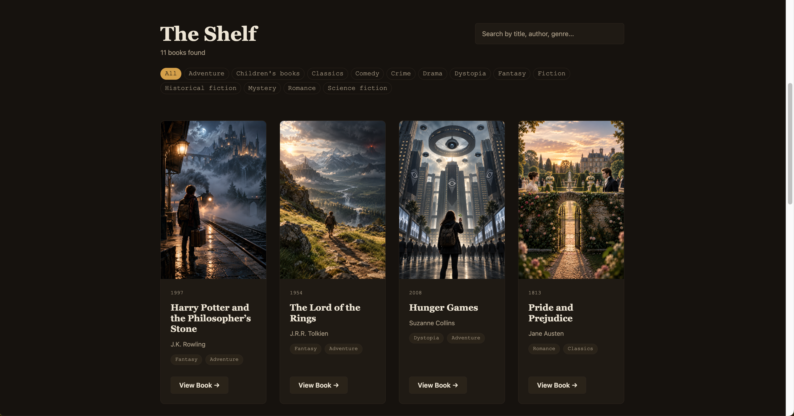
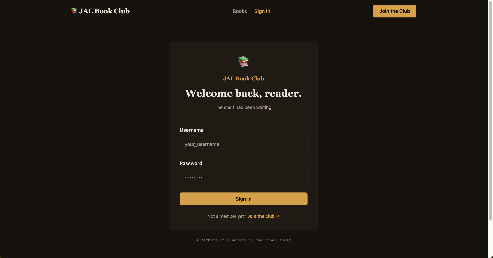
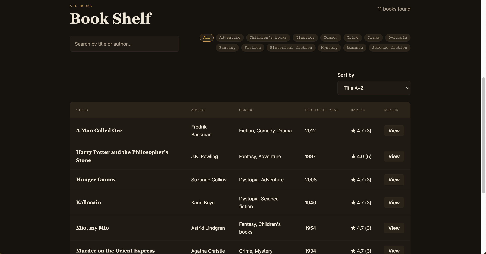
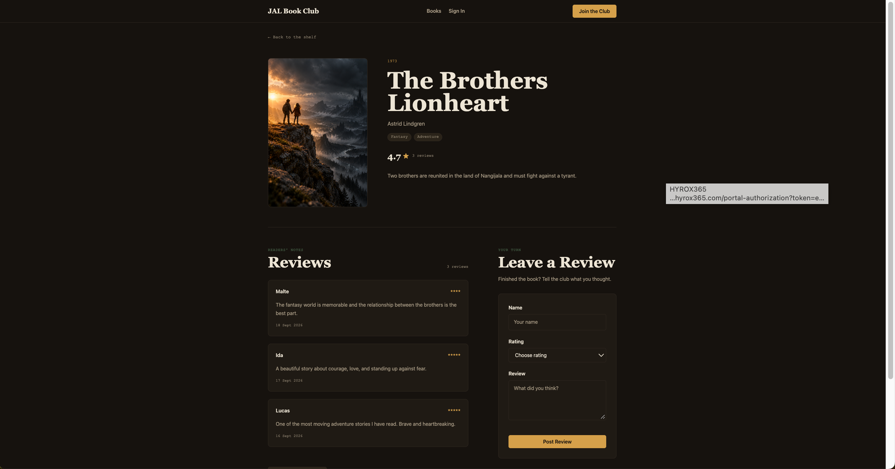
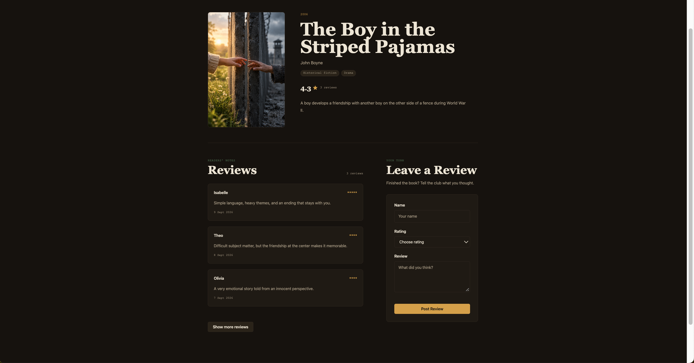
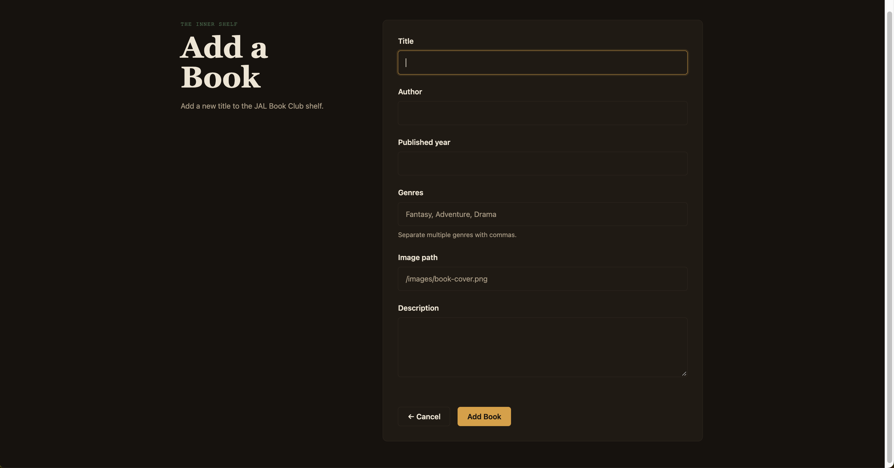

# JAL Book Club


## TL;DR

JAL Book Club är ett fullstack-projekt byggt med **Express, TypeScript, MongoDB** och en **vanilla JS-klient**. Besökare kan bläddra bland böcker och läsa recensioner, medan inloggade användare kan skapa böcker, skriva recensioner och hantera sitt konto. Projektet är byggt av tre personer med tydligt uppdelat ansvar: auth, böcker och recensioner, som innehåller full CRUD, JWT-baserad autentisering och en gemensam designad klient.

--- 

JAL Book Club är ett grupparbete i kursen **API-utveckling**. Projektet består av ett REST API byggt med **Express, TypeScript och MongoDB/Mongoose** samt en klient i **HTML, CSS och vanilla JavaScript**.

Besökare kan bläddra bland böcker, öppna en specifik bok, läsa recensioner och lämna egna recensioner. Inloggade användare får även tillgång till skyddade funktioner för att hantera användare, böcker och recensioner.

---

## Projektgrupp och ansvar

- **Alex** – Reviews + gemensam client styling/design system
- **Jennie** – Books
- **Lottie** – Users & Authentication

Varje person har ansvarat för sitt område från modell och API till relevant klientdel. Integration, testning och gemensam struktur har gjorts tillsammans.

---

## Så har vi arbetat

Vi började projektet med ett **gruppkontrakt** för att tydliggöra ansvar, kommunikation och hur vi hanterar problem och tekniska konflikter.

Projektet har sedan planerats med **GitHub Issues och Project Board**:

```text
Backlog → Ready → In Progress → Review → Done
```

Större krav har brutits ner till mindre Issues, exempelvis:

```text
[AUTH] Register user
[BOOKS] Get book by id
[REVIEW] Create review
[REVIEW CLIENT] Create book detail page
```

### Git workflow

Vi har arbetat med:

```text
main
  ↑
dev
  ↑
feature/* och fix/*
```

Arbetsflödet har varit:

1. skapa feature/fix-branch från uppdaterad `dev`
2. utveckla och testa lokalt
3. göra små och tydliga commits
4. öppna Pull Request mot `dev`
5. review och merge
6. stabil `dev` mergas senare till `main`

Projektets dagbok består av våra **dailys** i:

```text
docs/dailys/
```

---

## Tidsplan

Vi har arbetat efter en gemensam tidsplan och hittills hållit den.

| Dag | Plan |
| --- | --- |
| Måndag 14/9 | Backend färdig och integrationstest i Insomnia/Compass. Start av client och gemensam styling. |
| Tisdag 15/9 | Färdigställa huvudsakliga client-flöden. |
| Därefter | Småfix, responsive polish, edge cases, full testning och dokumentation. |
| Före inlämning | MongoDB-export, slutkontroll av board/dailys och stabil merge till `main`. |

---

## Teknik

**Backend:** Node.js, Express, TypeScript, MongoDB Atlas, Mongoose, bcrypt, JWT, cookie-parser, CORS och dotenv.

**Client:** HTML, CSS, vanilla JavaScript och Fetch API.

**Verktyg:** Git/GitHub, GitHub Issues, Project Board, Insomnia, MongoDB Compass och Biome.

---

## Databas och relationer

Databasen heter:

```text
JALBOOKCLUB
```

och innehåller:

```text
users
books
reviews
```

### Books

```text
_id
title
description
author
genres
image
published_year
```

### Reviews

```text
_id
name
content
rating
created_at
bookId
```

En Review är child till en Book och innehåller därför Bookens `_id` i `bookId`.

```text
Book._id
   │
   └──────→ Review.bookId
```

När klienten hämtar:

```http
GET /api/books/:id
```

hämtar API:t både boken och dess Reviews och returnerar dem tillsammans.

När en Book tas bort tas även dess Reviews bort för att undvika orphaned data.

---

## Authentication

Vid registrering hash:as lösenord med **bcrypt**.

Vid login skapas en **JWT** som sparas i en `httpOnly` cookie. Skyddade requests skickas med:

```js
credentials: "include"
```

och `verifyToken` middleware används på routes som kräver login.

Det finns ingen separat admin-roll – alla inloggade användare får använda de skyddade funktionerna.

---

## API

### Authentication

```http
POST /api/auth/register
POST /api/auth/login
POST /api/auth/logout
```

### Users – skyddade

```http
GET    /api/users
GET    /api/users/:id
PATCH  /api/users/:id
DELETE /api/users/:id
```

### Books

Publika:

```http
GET /api/books
GET /api/books/:id
```

Skyddade:

```http
POST   /api/books
PATCH  /api/books/:id
DELETE /api/books/:id
```

### Reviews

Publika:

```http
GET  /api/reviews
GET  /api/reviews/:id
POST /api/reviews
```

Skyddade:

```http
PATCH  /api/reviews/:id
DELETE /api/reviews/:id
```

---

## Client

Express serverar klienten från `public/`.

```text
index.html      → publik boklista
book.html       → specifik bok + reviews + review-form
login.html      → login
register.html   → register
members.html    → skyddat members area
```

CSS är uppdelad i:

```text
css/
├── base/
├── components/
├── pages/
└── style.css
```

Vi använder ett gemensamt designsystem med återanvändbara komponenter för navigation, footer, buttons, forms, tags, stats, book cards och review cards.

Grundprincip:

```text
CSS classes → styling
HTML id      → JavaScript hooks
```

---

## Extra JavaScript i klienten

Utöver grundkraven har vi lagt till några UX-förbättringar:

- `URLSearchParams` används för `book.html?id=<bookId>`
- bokinformation, genres och reviews renderas dynamiskt från API:t
- genomsnittligt betyg räknas ut i klienten
- review count uppdateras automatiskt
- senaste review visas först
- sex reviews visas initialt och fler kan visas med **Show more reviews**
- efter en lyckad `POST /api/reviews` hämtas boken på nytt så den nya reviewn visas direkt utan manuell reload

---

## Testning

Backend har testats manuellt med **Insomnia** och **MongoDB Compass**.

Vi har verifierat:

- Review CRUD
- register, login och logout
- publika och skyddade routes
- att PATCH/DELETE blockeras utan giltig auth
- Books ↔ Reviews-relationen
- att Reviews sparas med korrekt `bookId`
- att `GET /api/books/:id` returnerar rätt Reviews
- edge cases för saknat/felaktigt Book-id
- att en ny Review visas direkt efter POST

Vi har även lagt in mockdata med flera Reviews per Book för att testa klienten med realistisk data.

---

## Hur uppgiften är löst

### Users & Authentication
- registrering och duplicate username-kontroll
- bcrypt password hashing
- login/logout
- JWT i httpOnly cookie
- skyddade User-routes
- update/delete User

### Books
- Book model och CRUD
- publika GET-routes
- skyddade create/update/delete-routes
- relation till Reviews
- cascade delete av Reviews när Book tas bort
- publik boklista i klienten

### Reviews
- Review model och CRUD
- relation till Book via `bookId`
- rating validation 1–5
- kontroll att Book finns innan Review skapas
- publik POST
- skyddad PATCH/DELETE
- specifik boksida med Reviews
- review-form och automatisk uppdatering efter POST

---

## Kör projektet lokalt

Skapa en `.env` med:

```env
MONGODB_URL=
JWT_SECRET=
NODE_ENV=
CLIENT_URL=http://localhost:3000
```

Installera dependencies:

```bash
npm install
```

Starta projektet:

```bash
npm run dev
```

Öppna:

```text
http://localhost:3000
```

---

## Dokumentation

```text
README.md
docs/gruppkontrakt.md
docs/dailys/
```

MongoDB-export och slutlig testning läggs till inför inlämning.

## Skärmdumpar

### Landningssida


### Landningssida med tillhörande bokhylla


### Login


### Books


### Bookdetails


### Bookreview


### Add Book


### Members
